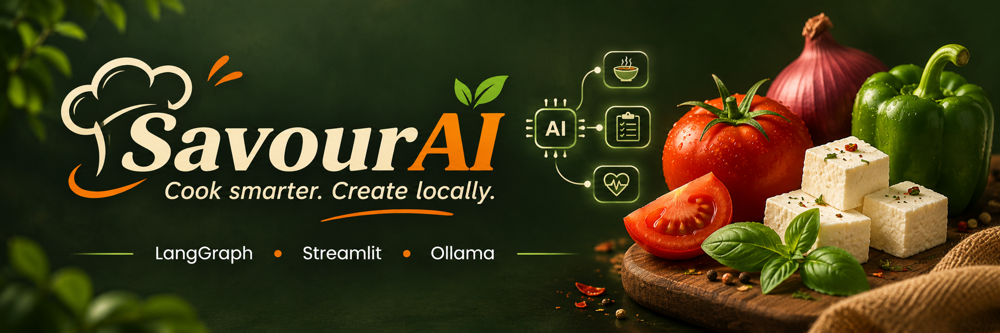
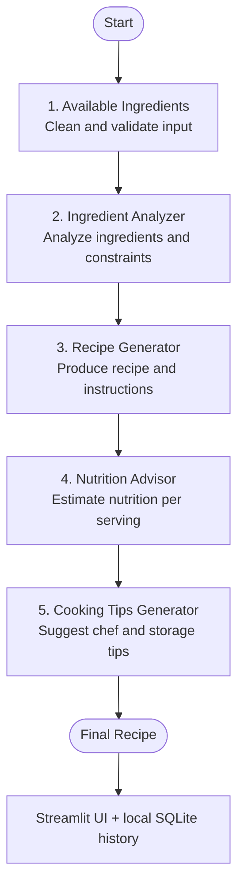
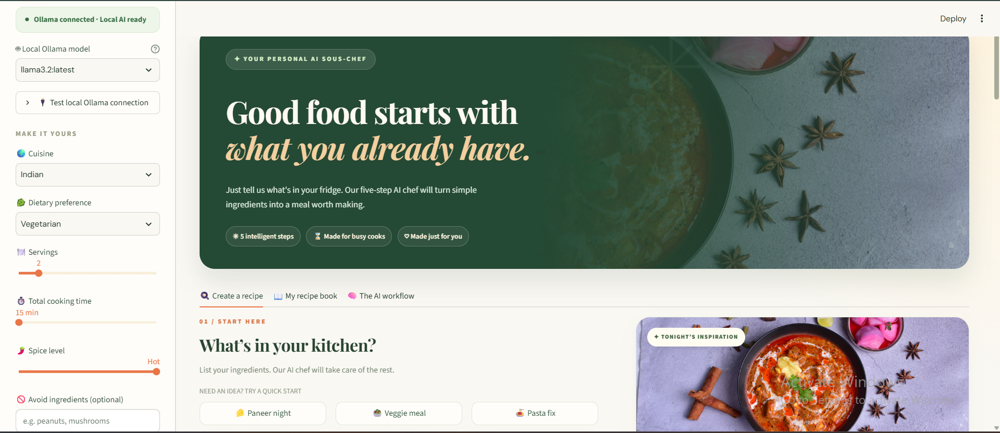
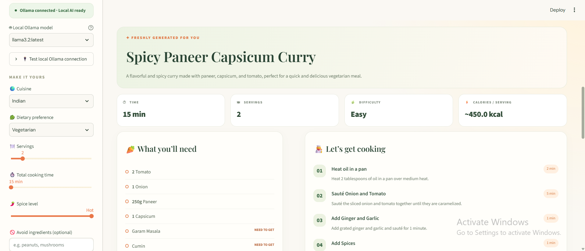

# 🍋 SavourAI — Your Local AI Recipe Studio

**Turn the ingredients you already have into recipes with LangGraph and Ollama.**

Local-first AI · No cloud LLM API key · Free to run with your own hardware


---

## 📖 Overview

**SavourAI** is an AI-powered cooking assistant that turns a list of ingredients into a practical recipe. It uses a **five-node LangGraph workflow**, a food-themed **Streamlit** interface, and **Ollama with Llama 3.2** for local language-model inference.

Enter ingredients such as **tomato, onion, paneer, and capsicum**; customize your preferences; and get a recipe with cooking steps, suggested quantities, approximate nutrition, and chef tips.

> **Local-first:** Recipe generation talks to Ollama on your own computer. No Groq or OpenAI API key is needed. After initial installation, the AI workflow and locally saved recipe history can work offline. Some decorative online images/fonts may need an internet connection.

## ✨ Features

- 🥕 **Ingredient-based cooking:** Generates ideas based on ingredients you provide.
- 🎛️ **Personal preferences:** Cuisine, dietary preference, servings, cooking-time limit, spice level, and ingredients to avoid.
- 🧠 **Five real LangGraph nodes:** Input validation, ingredient analysis, recipe creation, nutrition advice, and cooking tips.
- 📋 **Detailed recipes:** Names, descriptions, ingredient quantities, cooking steps, timing, and missing essentials when applicable.
- 🥗 **Nutrition overview:** Approximate calories per serving, protein, carbohydrates, fat, and fiber.
- 👨‍🍳 **Chef guidance:** Cooking, serving, storage, and substitution tips.
- 💾 **Recipe library:** SQLite-backed history, favorites, revisiting/deleting saved recipes, and Markdown export.
- 🖥️ **Local model controls:** Discover installed Ollama models and test the local connection.

## 🧩 How the AI works



The first node handles input in Python; the next **four nodes call the local Ollama model**. `workflow.py` builds and runs the graph, while `ollama_client.py` communicates with Ollama's local HTTP API.

## 🧰 Tech stack

| Component | Technology | Purpose |
|---|---|---|
| Frontend | Streamlit | Interactive recipe dashboard |
| Orchestration | LangGraph | Five-node AI workflow |
| Local LLM | Ollama + Llama 3.2 | Recipe, nutrition, and tip generation |
| Backend | Python | Agent execution and application logic |
| Storage | SQLite | Saved recipes and favorites |
| Configuration | python-dotenv | Optional local environment settings |

## 🚀 Run locally (Windows / VS Code)

### Requirements

- **Python 3.12** recommended
- **Ollama** installed and running on your PC
- **Llama 3.2** downloaded through Ollama
- Git and VS Code (recommended, not required to run the app)

### 1. Clone the repository

```powershell
git clone https://github.com/Madhav-pareek27/SavourAI-Ollama-Recipe-Generator.git
cd SavourAI-Ollama-Recipe-Generator
```

### 2. Prepare Ollama

Install [Ollama](https://ollama.com/download) if needed, then run:

```powershell
ollama pull llama3.2
ollama list
```

Start the Ollama desktop app if it is not running. If you are using Ollama without the desktop background service, run `ollama serve` in another terminal **only when a server is not already running**.

### 3. Set up a Python environment

```powershell
py -3.12 -m venv .venv
.\.venv\Scripts\Activate.ps1
python -m pip install -r requirements.txt
```

If `py -3.12` isn't available, check your Python installations with `py -0p` and use a compatible version.

### 4. Launch the app

```powershell
python -m streamlit run app.py
```

Open **http://localhost:8501** in your browser.

**Quick start on Windows:** You can also double-click `start_windows.bat` after installing Ollama and downloading the model. The batch file sets up Python dependencies and launches Streamlit.

### Optional: change Ollama settings

The defaults are already configured in code. You **do not need a `.env` file** for a standard local setup. To customize, create `.env` in the project root with:

```dotenv
OLLAMA_MODEL=llama3.2
OLLAMA_URL=http://127.0.0.1:11434
```

You can copy the included `.env.example` to `.env` if you have added that example file to the repository. Do **not** commit your real `.env`.

## 🖼️ Screenshots

A screenshot of the running Streamlit dashboard will help visitors understand the interface.

1. Run SavourAI on your computer.
2. Capture the dashboard and a generated recipe.
3. Save the images as `assets/screenshots/dashboard.png` and `assets/screenshots/recipe-result.png`.
4. Replace this section with the following Markdown **after the files exist**:

```markdown


```

## 📁 Repository structure

```text
SavourAI-Ollama-Recipe-Generator/
├── app.py                 # Streamlit UI
├── workflow.py            # Five LangGraph nodes
├── ollama_client.py       # Local Ollama HTTP client
├── storage.py             # SQLite recipe history and favorites
├── utils.py               # Input validation and Markdown export
├── requirements.txt       # Python dependencies
├── start_windows.bat      # Windows launcher
├── START_HERE.txt         # Quick-start notes
├── .gitignore             # Excluded private/generated files
├── .streamlit/            # Streamlit app configuration
├── tests/                 # Offline tests
├── data/                  # Local recipe data (not for sharing)
└── assets/
    └── savourai-banner.png
```

## 🧪 Run tests

```powershell
python -m pip install pytest
python -m pytest -q
```

The graph supports test injection so automated tests can run without making live Ollama requests.

## 🛠️ Troubleshooting

| Problem | Suggested fix |
|---|---|
| `ollama` command not recognized | Install Ollama, restart your terminal, and check `ollama list`. |
| Cannot connect to Ollama | Start the Ollama app or its server, then retry the in-app connection test. |
| `llama3.2` not available | Run `ollama pull llama3.2` and check `ollama list`. |
| `No module named streamlit` | Activate `.venv` and run `python -m pip install -r requirements.txt`. |
| Invalid JSON generated | Retry with a simpler request; small local models occasionally return malformed output. |
| Generation is slow | Local model speed depends on available CPU, GPU, and memory. |
| Port 8501 is already in use | Stop the previous app with `Ctrl+C` or open the port Streamlit reports. |

## 🔐 Privacy and important notes

- **No cloud AI key required:** AI generation uses the local Ollama endpoint at `127.0.0.1:11434` by default.
- **Local data:** Saved recipes are kept on your machine using SQLite; don't publish personal database files.
- **External UI assets:** Some decorative images or fonts may be loaded from external websites when the browser has internet access.
- **Nutrition estimates:** These are AI-generated approximations, **not** measurements from a verified nutrition database. Check ingredient labels and dietary restrictions independently, particularly for allergies.
- **Cooking safety:** Follow standard food handling, temperature, and storage guidance.

## 👨‍💻 Maintainer

Built and maintained by **[Madhav-pareek27](https://github.com/Madhav-pareek27)**.

If you find the project useful, consider starring the repository ⭐
